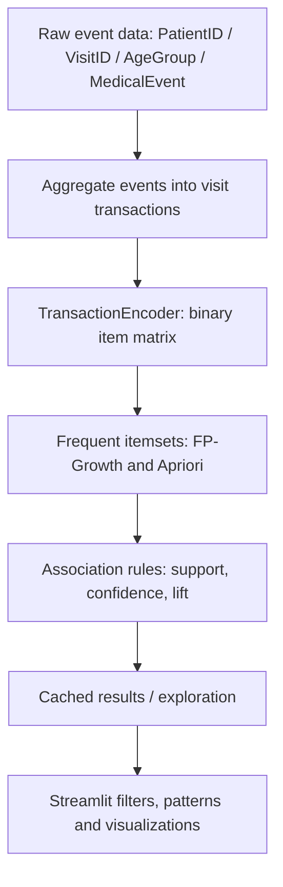

# Clinical Comorbidity & Treatment Pattern Mining

[](https://github.com/Alan-911/clinical-comorbidity-dashboard/actions/workflows/validate.yml) [](https://github.com/Alan-911/clinical-comorbidity-dashboard/actions/workflows/security.yml)

**Reproducible association-rule mining · Interactive analytics · Educational research prototype**

[Live Streamlit dashboard](https://clinical-comorbidity-dashboard.streamlit.app) · [Analysis notebook](notebooks/clinical_comorbidity_analysis.ipynb) · [Project report](docs/Clinical_Comorbidity_Dashboard_Report.pdf) · [Source](app.py)

## Dashboard preview


*Illustrative dashboard mockup supplied for the project's README. It is not a verified browser screenshot or a source of benchmark measurements. For the current interactive implementation, [open the Streamlit dashboard](https://clinical-comorbidity-dashboard.streamlit.app/).*

## Overview

This project analyzes **co-occurrence patterns among clinical events** using frequent-itemset mining and association rules. It turns event-level sample records into visit-level transactions, mines candidate itemsets with **FP-Growth** and **Apriori**, and presents patterns in an interactive Streamlit interface.

**Research-only scope:** The data and clinical-like panels are illustrative. Patterns indicate statistical association within sample transactions, **not causation, diagnoses, individualized risk predictions or treatment guidance**. This is not a medical device or clinically validated decision-support product. No regulatory certification or external healthcare partnership is claimed.

## Verified repository data

Counts below refer to the **checked-in CSV files**, not an external healthcare population or live patient records.

| Dataset | File | Rows |
| --- | --- | ---: |
| Raw medical-event records | [data_raw/raw_data.csv](data_raw/raw_data.csv) | 5,382 |
| Visit-level transactions | [transactions/transactions.csv](transactions/transactions.csv) | 2,564 |
| Cached association rules | [data_processed/association_rules.csv](data_processed/association_rules.csv) | 177 |
| Cached frequent itemsets | [data_processed/frequent_itemsets.csv](data_processed/frequent_itemsets.csv) | 117 |

These are different units. Each raw row is an event; each transaction aggregates events for one visit; each rule is a mined relationship. The cached rules should not be confused with the number generated by a fresh algorithm run, which can depend on processing choices and thresholds.

**Important detail:** Transactions contain a mix of conditions, medications, age-group flags (`Age_*`) and visit-frequency flags (`Freq_*`). These are **not all diagnoses**. Filtering by age/frequency or medication can produce useful exploratory associations, but the patterns must not be described as clinical diagnoses or treatment effects.

## Pipeline



The analytical notebook documents the full workflow. The dashboard normally loads the checked-in rules CSV; it recomputes rules using FP-Growth if that file is absent. Algorithm comparison timings are computed separately on the same transaction file. **A failed benchmark is reported as unavailable, not replaced with invented numbers.**

## What the application includes

| Capability | Implementation | Caveat |
| --- | --- | --- |
| Interactive association-rule exploration | [app.py](app.py) | Exact item matching for antecedent and consequent filters |
| FP-Growth and Apriori comparison | `get_algo_timings()` in [app.py](app.py) | Single-run timing is environment-dependent, not a universal speed claim |
| Notebook experiments and plots | [clinical_comorbidity_analysis.ipynb](notebooks/clinical_comorbidity_analysis.ipynb) | Data and algorithm settings determine results |
| Summary statistics and pattern views | [app.py](app.py) | Exploratory associations only |
| Patient, appointment and laboratory panels | [app.py](app.py) | **Fictional demonstration UI**, not connected medical records |
| Automated data/schema checks | [validate_data.py](scripts/validate_data.py) | Validates checked-in files and basic rule constraints |
| Rule filtering tests | [test_rule_filters.py](tests/test_rule_filters.py) | Regression tests for exact item matching |

### Interpreting the measures

For a rule **A → B**:

- **Support:** proportion of visits containing both A and B.
- **Confidence:** proportion of visits with A that also contain B; `P(B | A)`, not a probability that A causes B.
- **Lift:** `P(A,B) / (P(A) × P(B))`. Values above 1 indicate above-baseline co-occurrence in the analyzed sample, not clinical significance or causality.

An association may reflect the way sample data were generated, common treatment pathways, demographic factors or repeated visits. Rule ranking alone cannot establish medical validity.

## Local development

Use a supported Python environment (Python 3.11 recommended).

```bash
git clone https://github.com/Alan-911/clinical-comorbidity-dashboard.git
cd clinical-comorbidity-dashboard
python -m venv .venv
# Activate the environment for your operating system
python -m pip install -r requirements.txt

# Check checked-in data and algorithms
python scripts/validate_data.py
python -m unittest discover -s tests -v

# Run the dashboard
streamlit run app.py
```

The Streamlit development server normally opens at `http://localhost:8501`.

### Experiment reproduction

Open [the notebook](notebooks/clinical_comorbidity_analysis.ipynb) to inspect event loading, transaction encoding, both itemset-mining algorithms, rule extraction and visualizations.

The notebook also discusses Dolt-based data versioning. The public repository includes CSV snapshots; a working, authenticated Dolt remote is **not included**. The CSV snapshots are sufficient to inspect the present analytical sample, but reproducing its complete generation history requires the upstream data source.

## Repository map

```text
app.py                                  Streamlit UI and exploratory analysis
src/rule_engine.py                      Independently testable rule-item matching
tests/test_rule_filters.py              Matching and filtering regression tests
scripts/validate_data.py                Source/cached CSV validation
.github/workflows/validate.yml          Syntax, data and unit checks
notebooks/clinical_comorbidity_analysis.ipynb   Apriori/FP-Growth experiments
data_raw/                               Event-level data
transactions/                           Visit-level transactions
data_processed/                         Cached itemsets and rules
visualizations/                         Project plots and illustrations
docs/                                   Report and presentation materials
```

## Engineering priorities

1. Extract mining and UI components from the monolithic Streamlit app into focused modules.
2. Consolidate transformations in one reproducible event-to-rule pipeline.
3. Separate demonstration screens from analytical results to prevent clinical ambiguity.
4. Add multi-run, environment-recorded performance benchmarks and data-lineage checks.
5. Pin compatible dependencies and test clean environment deployment.
6. Add appropriate uncertainty assessments before drawing conclusions about real-world patterns.

## Limitations

- Illustrative data cannot establish real-world healthcare prevalence or clinical effectiveness.
- Visit-level transactions are not independent if several visits belong to the same patient.
- Co-occurrence rules ignore clinical chronology, confounders and sampling mechanisms.
- Cached files require provenance checks to demonstrate equivalence with notebook output.
- No patient-specific recommendations or regulatory compliance status are asserted.

## Author

**Yves Alain Iragena** · [Portfolio](https://alan-911.github.io/my-portfolio/) · [GitHub](https://github.com/Alan-911)

This repository is an educational data-science engineering project, not clinical software.


## Repository quality and security

- [Continuous integration](.github/workflows/validate.yml), [CodeQL and secret scanning](.github/workflows/security.yml).
- [Security reporting policy](SECURITY.md) and [contribution guidelines](CONTRIBUTING.md).
- Data checks validate the checked-in snapshots; they do not establish clinical safety, causality or real-world medical validity.
- Licensing for reuse should be confirmed with the project owner; no new license is granted by these workflow updates.
